# Telecom Customer Churn Analysis (SQL + Python + Power BI Guide)

> Identified which customers leave, why they leave, and how much revenue it costs, then built a SQL-based risk model to flag customers for retention campaigns.

**Headline results** (7,043 customers, IBM Telco sample data):
- **26.54%** of customers churned, costing about **$1.67M a year** (30.5% of monthly recurring revenue).
- **Month-to-month contracts churn at 42.71%** vs 2.83% on 2-year contracts.
- **47.44%** of customers churn in their first 12 months of tenure.
- The SQL risk score separates customers well: **56.90%** actual churn in the High band vs 5.42% in Low (descriptive, not out-of-sample; see Limitations).

[Full findings and recommendations](#findings-and-recommendations)

## Business Problem
A telecom provider is losing customers and does not know which segments are at risk. This project answers:
1. What is the overall churn rate and how much revenue does it cost?
2. Which contract types, services, and payment methods drive churn?
3. At what point in the customer lifecycle do people leave?
4. Which current customers should the retention team contact first?

## Tools & Skills
`PostgreSQL` | `SQL` | `CTEs` | `Window Functions` | `Subqueries` | `Views` | `Indexing & Query Optimization` | `Data Cleaning` | `Python` | `matplotlib` | `Power BI (build guide)`

## Dataset
IBM Telco Customer Churn sample dataset (also published on Kaggle as "Telco Customer Churn"): 7,043 customers, 21 columns (demographics, services, contract, billing, churn status). The CSV in `data/` was downloaded from IBM's public GitHub repository (`IBM/telco-customer-churn-on-icp4d`).

## Project Structure
```
telco-churn-sql/
├── data/            # raw CSV
├── sql/
│   └── telco_churn_analysis.sql
├── scripts/         # run_analysis.py (runs the SQL), make_images.py, make_more_charts.py
├── results/         # query_results.md, EXPLAIN plan text
├── dashboard/       # view export CSV, 2 dashboard pages (PNG)
├── powerbi/         # Power BI build guides (and the .pbix once you build it)
├── images/          # EXPLAIN plan renders + extra charts
└── README.md
```

## Approach
1. **Data cleaning:** converted text to numeric types, fixed 11 blank `TotalCharges` values, created tenure buckets and a binary churn flag.
2. **Exploratory analysis:** 11 business questions answered with SQL (joins, CTEs, aggregations, window functions).
3. **Risk scoring model:** built a rule-based score in SQL (view `v_customer_risk`) and validated it against actual churn.
4. **Optimization:** added composite indexes; query time went from 0.779 ms to 0.422 ms (see `/images` and the caveat below).
5. **Dashboard:** `v_churn_dashboard` exported to `dashboard/v_churn_dashboard.csv`. The dashboard images in this repo (`dashboard/churn_dashboard.png` and `churn_dashboard_page2.png`) are generated with Python/matplotlib from the same data. The Power BI build steps, DAX measures and layout are in [powerbi/POWERBI_GUIDE.md](powerbi/POWERBI_GUIDE.md), with a beginner-friendly walkthrough in [powerbi/POWERBI_STEP_BY_STEP.md](powerbi/POWERBI_STEP_BY_STEP.md).

## Findings and Recommendations
All numbers come from running `sql/telco_churn_analysis.sql` on PostgreSQL 16.2 (full output in [results/query_results.md](results/query_results.md)).

### Key findings
| Insight | Result |
|---|---|
| Overall churn rate | **26.54%** (1,869 of 7,043) |
| Month-to-month vs. 2-year contract churn | **42.71% vs 2.83%** (one-year: 11.27%) |
| Churn in first 12 months of tenure | **47.44%** (vs 9.51% for 49+ months) |
| Annualized revenue lost to churn | **$1,669,570** ($139,131/month, 30.5% of MRR) |
| Churn without tech support vs. with | **41.64% vs 15.17%** (internet customers only) |
| High-risk band actual churn rate | **56.90%** (Medium 25.07%, Low 5.42%) |
| Biggest revenue-loss segment | Month-to-month + Fiber optic = **72.2%** of monthly revenue lost |
| Worst payment method | Electronic check: 53.73% churn among month-to-month customers |
| Churners leave early | 20.3% of all churners leave in month 1; 55.5% within 12 months |

### Recommendations
Ordered by expected impact. Each one is tied to the finding behind it.

1. **Move month-to-month customers onto 1 or 2-year contracts** (discounts or perks). Month-to-month churn is 42.71% vs 2.83% on 2-year, and Month-to-month + Fiber optic accounts for 72.2% of monthly revenue lost.
2. **Run an onboarding program for the first 12 months.** 47.44% of customers churn in that window, and 20.3% of all churners leave in month 1.
3. **Bundle tech support and online security with fiber plans.** Internet customers without tech support churn at 41.64% vs 15.17% with it. This is a correlation, so test it with a pilot before rolling it out (see Limitations).
4. **Push electronic-check customers toward auto-pay.** Electronic check has 53.73% churn among month-to-month customers.
5. **Give the retention team the "High Risk, not yet churned" list, sorted by monthly revenue.** The High-risk band churned at 56.90% vs 5.42% for Low, so it is a good place to focus outreach.

**Why this matters:** churn costs about $1.67M a year (30.5% of monthly recurring revenue), so even a modest reduction in the first two groups above is worth a lot.

## Dashboard and Charts

### Dashboard
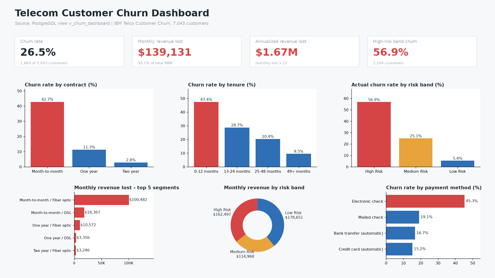

**Page 2: drivers & segments**
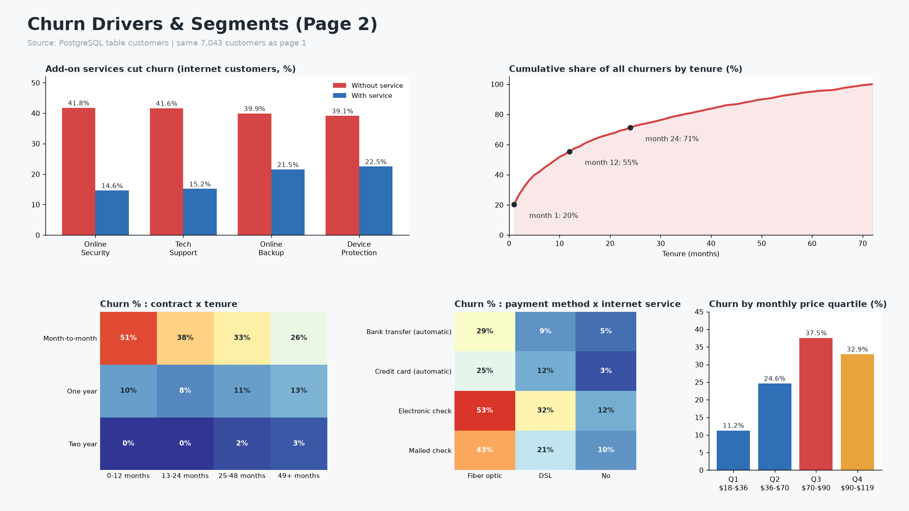

### More charts
| | |
|---|---|
| 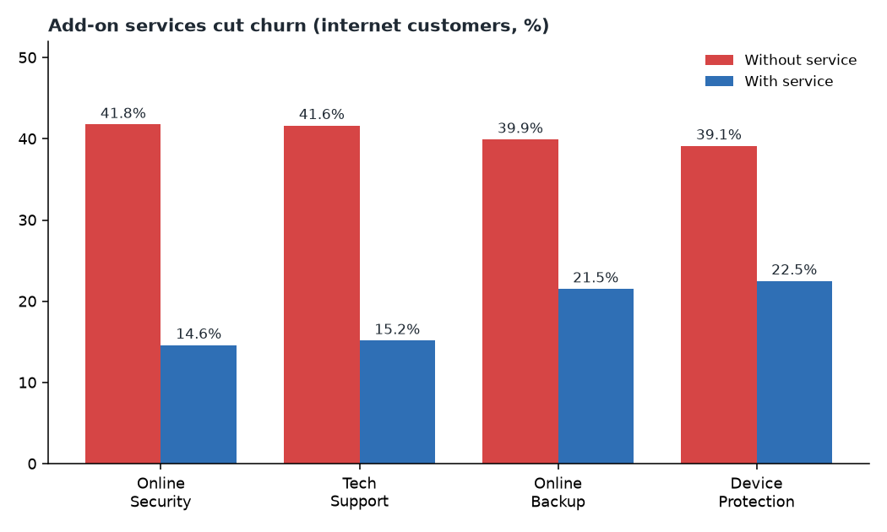 | 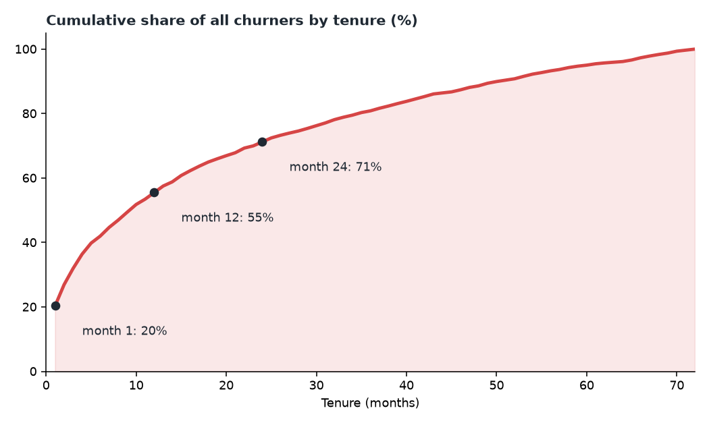 |
| 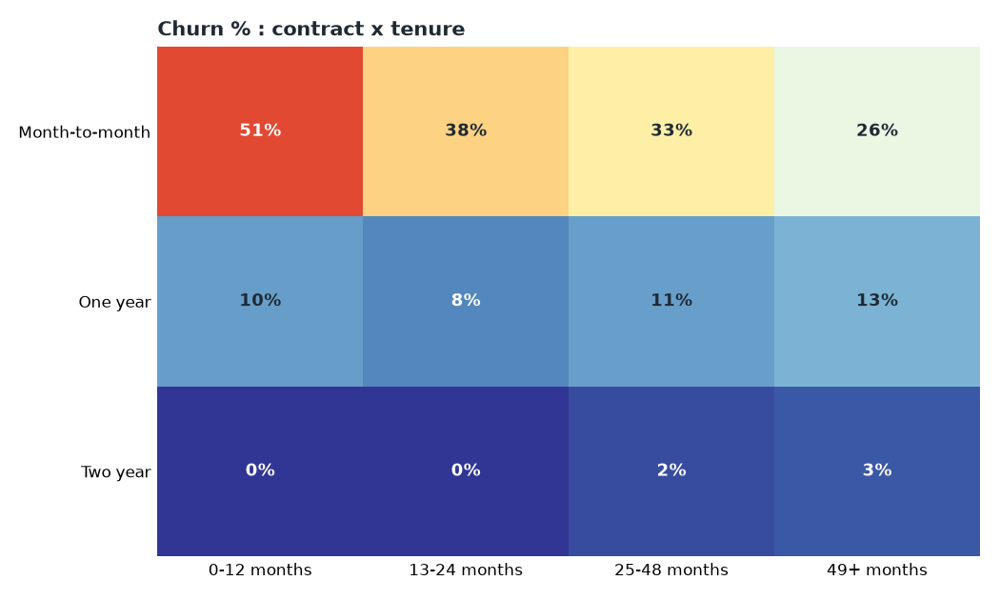 | 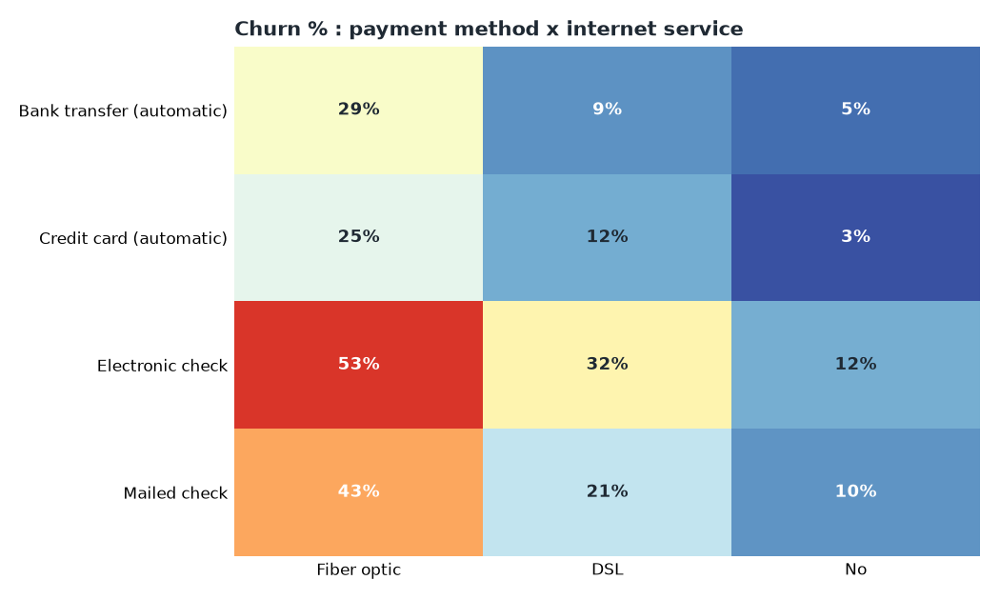 |
| 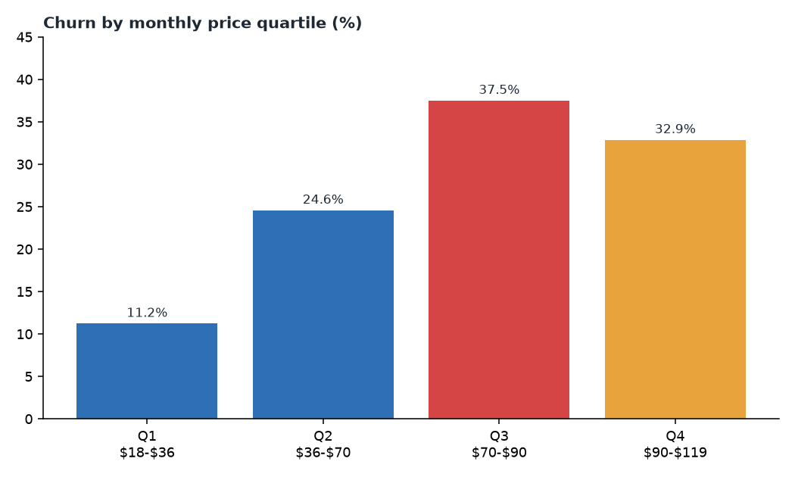 | 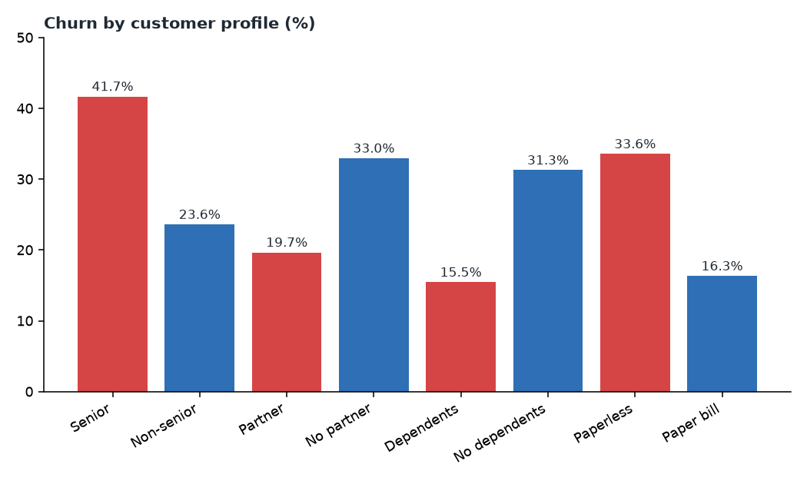 |
| 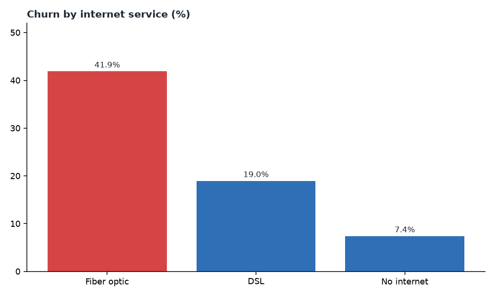 | 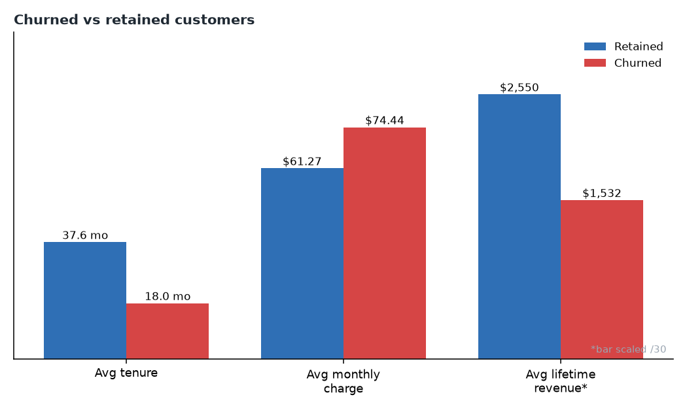 |

## Query Optimization (EXPLAIN ANALYZE)
| | Plan | Execution time |
|---|---|---|
| Before index | Seq Scan on `customers` | 0.779 ms |
| After `idx_customers_contract_churn` + `ANALYZE` | Bitmap Index Scan | 0.422 ms |

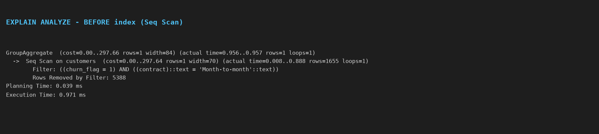
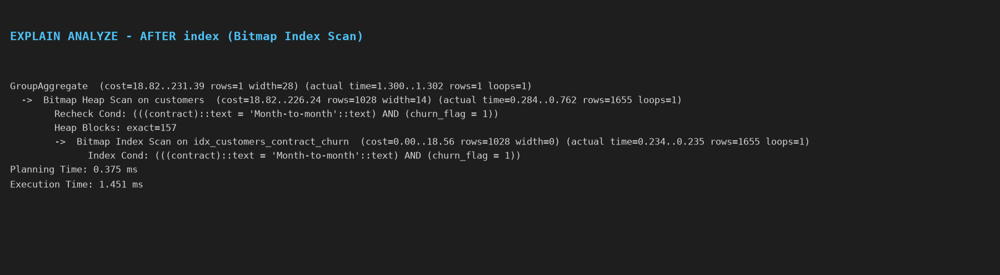

The images above are rendered from the real `EXPLAIN ANALYZE` text output (`results/explain_before.txt`, `results/explain_after.txt`), not pgAdmin screenshots.

Caveat: the table has only 7,043 rows, so both runs are sub-millisecond and the absolute gain is small. The "before" plan also ran on a table with no statistics yet (it estimated `rows=1`; the real count was 1,655), so part of the improvement comes from `ANALYZE`, not only the index. The index pays off as the table grows.

## Limitations
- **Risk model is rule-based:** the point weights are hand-picked from the patterns in Q2-Q5 and were evaluated on the same data they were derived from. There is no train/test split, so the 56.9% vs 5.4% separation between bands is descriptive, not a measured out-of-sample result.
- **Retention list:** some high-risk, not-yet-churned customers are long-tenure month-to-month customers who score high mainly because of contract, payment and service flags. Tenure is only penalized for the first 12 months.
- **Correlation, not causation:** customers with tech support churn less, but the data cannot show that adding tech support would cause lower churn.
- **Revenue lost** uses `monthly_charges` of churned customers x 12; it ignores discounts, one-time fees and what those customers might have paid in the future.
- **Performance test** is on a 7,043-row table, so timings are tiny (see the caveat above).

## How to Run
```bash
createdb telco_churn
psql -d telco_churn -f sql/telco_churn_analysis.sql
# then, inside psql:
# \copy telco_raw FROM 'data/WA_Fn-UseC_-Telco-Customer-Churn.csv' WITH (FORMAT csv, HEADER true);
```
Run Section 1 (schema), load the CSV, then run the remaining sections.

No PostgreSQL install? `pip install pgserver psycopg2-binary pandas matplotlib`, then
`python scripts/run_analysis.py <empty_data_dir>` runs everything and writes `results/` and `dashboard/v_churn_dashboard.csv`;
`python scripts/make_images.py` regenerates the page 1 dashboard and EXPLAIN images, and
`python scripts/make_more_charts.py <same_data_dir>` regenerates page 2 and the extra charts.
