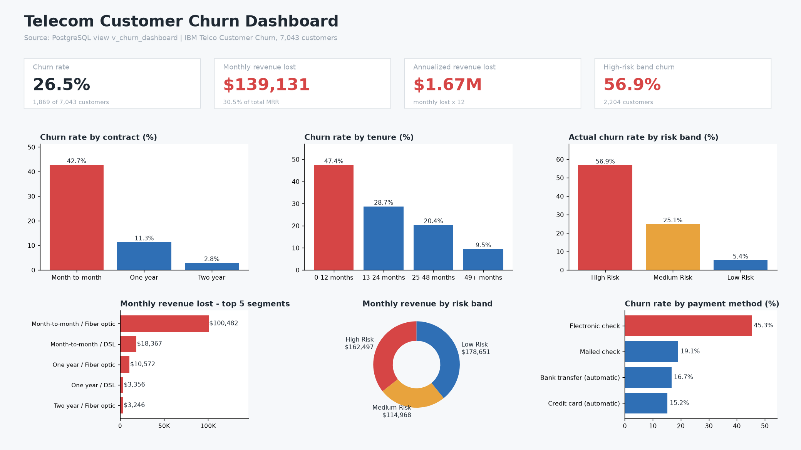
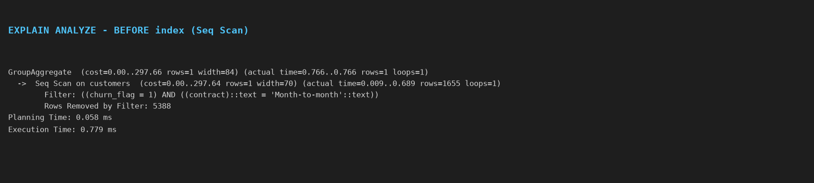
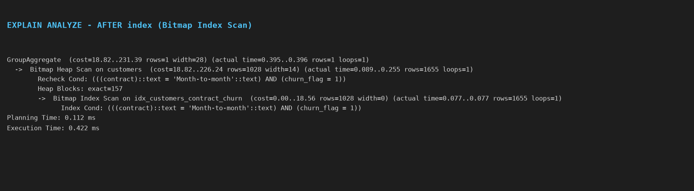

# Telecom Customer Churn Analysis (SQL + Power BI)

> Identified which customers leave, why they leave, and how much revenue it costs, then built a SQL-based risk model to flag customers for retention campaigns.

## Business Problem
A telecom provider is losing customers and does not know which segments are at risk. This project answers:
1. What is the overall churn rate and how much revenue does it cost?
2. Which contract types, services, and payment methods drive churn?
3. At what point in the customer lifecycle do people leave?
4. Which current customers should the retention team contact first?

## Tools & Skills
`PostgreSQL` | `SQL` | `CTEs` | `Window Functions` | `Subqueries` | `Views` | `Indexing & Query Optimization` | `Data Cleaning` | `Power BI`

## Dataset
IBM Telco Customer Churn (Kaggle): 7,043 customers, 21 columns (demographics, services, contract, billing, churn status).

## Project Structure
```
telco-churn-sql/
├── data/            # raw CSV
├── sql/
│   └── telco_churn_analysis.sql
├── scripts/         # run_analysis.py (runs the SQL), make_images.py (charts)
├── results/         # query_results.md, EXPLAIN plan text
├── dashboard/       # view export CSV, dashboard PNG, Power BI guide
├── images/          # EXPLAIN plan screenshots
└── README.md
```

## Approach
1. **Data cleaning:** converted text to numeric types, fixed 11 blank `TotalCharges` values, created tenure buckets and a binary churn flag.
2. **Exploratory analysis:** 11 business questions answered with SQL (joins, CTEs, aggregations, window functions).
3. **Risk scoring model:** built a rule-based score in SQL (view `v_customer_risk`) and validated it against actual churn.
4. **Optimization:** added composite indexes; query time went from 0.779 ms to 0.422 ms (see `/images` and the caveat below).
5. **Dashboard:** `v_churn_dashboard` exported to `dashboard/v_churn_dashboard.csv`; 1-page dashboard in `dashboard/churn_dashboard.png`. To rebuild it in Power BI, follow [dashboard/POWERBI_GUIDE.md](dashboard/POWERBI_GUIDE.md).

## Key Findings
All numbers come from running `sql/telco_churn_analysis.sql` on PostgreSQL 16.2 (full output in [results/query_results.md](results/query_results.md)).

| Insight | Result |
|---|---|
| Overall churn rate | **26.54%** (1,869 of 7,043) |
| Month-to-month vs. 2-year contract churn | **42.71% vs 2.83%** (one-year: 11.27%) |
| Churn in first 12 months of tenure | **47.44%** (vs 9.51% for 49+ months) |
| Annualized revenue lost to churn | **$1,669,570** ($139,131/month, 30.5% of MRR) |
| Churn without tech support vs. with | **41.64% vs 15.17%** (internet customers only) |
| High-risk band actual churn rate | **56.90%** (Medium 25.07%, Low 5.42%) |
| Biggest revenue-loss segment | Month-to-month + Fiber optic = **72.2%** of monthly revenue lost |
| Worst payment method | Electronic check: 53.73% churn among month-to-month customers |
| Churners leave early | 20.3% of all churners leave in month 1; 55.5% within 12 months |

### Dashboard


### Query optimization (EXPLAIN ANALYZE)
| | Plan | Execution time |
|---|---|---|
| Before index | Seq Scan on `customers` | 0.779 ms |
| After `idx_customers_contract_churn` + `ANALYZE` | Bitmap Index Scan | 0.422 ms |




Caveat: the table has only 7,043 rows, so both runs are sub-millisecond and the absolute gain is small. The "before" plan also ran on a table with no statistics yet (it estimated `rows=1`; the real count was 1,655), so part of the improvement comes from `ANALYZE`, not only the index. The index pays off as the table grows.

## Recommendations
- Offer discounts to move month-to-month customers onto 1 or 2-year contracts.
- Run an onboarding program for customers in their first 12 months.
- Bundle tech support and online security with fiber plans.
- Push customers on electronic check toward auto-pay.
- Hand the "High Risk, not yet churned" list to the retention team, sorted by monthly revenue.

## How to Run
```bash
createdb telco_churn
psql -d telco_churn -f sql/telco_churn_analysis.sql
# then, inside psql:
# \copy telco_raw FROM 'data/WA_Fn-UseC_-Telco-Customer-Churn.csv' WITH (FORMAT csv, HEADER true);
```
Run Section 1 (schema), load the CSV, then run the remaining sections.

No PostgreSQL install? `pip install pgserver psycopg2-binary pandas matplotlib`, then
`python scripts/run_analysis.py <empty_data_dir>` runs everything and writes `results/` and `dashboard/v_churn_dashboard.csv`;
`python scripts/make_images.py` regenerates the images.

## Author
**Your Name** | [LinkedIn](https://linkedin.com/in/yourprofile) | your.email@example.com
